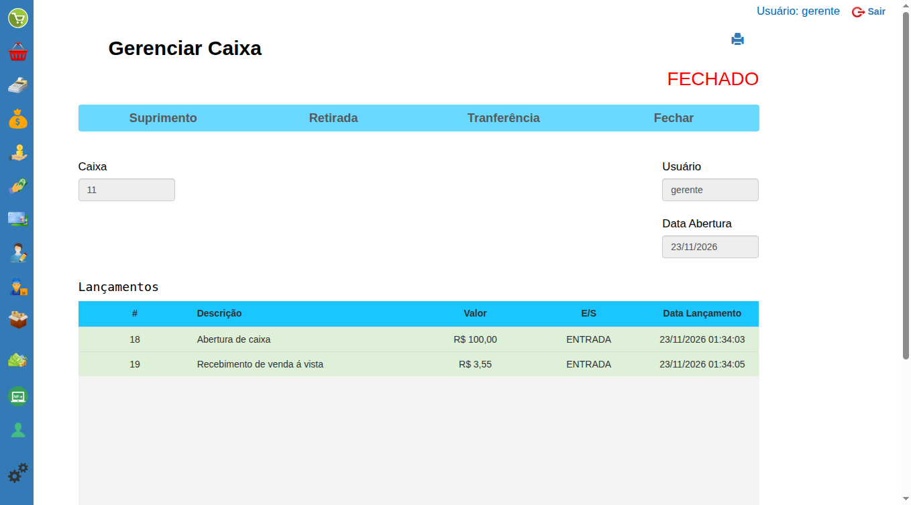

# DEF-VENDA-003 — Desconto e acréscimo aplicados trocados no valor da parcela

| Campo | Valor |
| --- | --- |
| ID | DEF-VENDA-003 |
| Módulo | Venda |
| Classe sob teste | `net.originmobi.pdv.service.VendaService` (métodos `aprazo` e `avistaDinheiro`) |
| Funcionalidade | Fechamento de venda com desconto e/ou acréscimo |
| Encontrado por | Alexandre Porto |
| Data | 23/09/2026 |
| Severidade | Média/Alta (valor financeiro incorreto) |
| Status | Aberto |

## Passos para reproduzir

1. Com um caixa aberto, abrir venda com produtos totalizando **R$ 3,50**.
2. No modal de pagamento, informar **Desconto = 1,00** e **Acréscimo = 0,95**.
3. Fechar a venda à vista em dinheiro.
4. Abrir o caixa (`/caixa/gerenciar/{codigo}`) e olhar a linha
   "Recebimento de venda á vista" na lista de lançamentos.

## Resultado esperado

O valor recebido é `(produtos + acréscimo) − desconto` = `(3,50 + 0,95) − 1,00`
= **R$ 3,45**.

## Resultado obtido

A venda fecha com "Venda finalizada com sucesso". Dos valores que ela grava, dois
estão certos e um está errado (consulta ao banco depois do teste de sistema):

| Onde | Valor gravado | Correto? |
| --- | --- | --- |
| `venda.valor_total` | 3,45 | sim |
| `receber.valor_total` | 3,45 | sim |
| lançamento de entrada no caixa (`caixa_lancamento.valor`) | **3,55** | **não** (esperado 3,45) |

O "Total R$ 3,50" que aparece no pedido e na lista de pedidos é o
`valor_produtos` (a soma dos produtos) e **não muda** com desconto ou acréscimo.
Por isso olhar o pedido não mostra o defeito: o valor errado só aparece na tela do
caixa e nas parcelas. Vendas sem desconto e sem acréscimo lançam o valor certo
(R$ 3,50).

## Causa raiz (análise de código)

No `fechaVenda`, os valores por parcela são calculados corretamente:

```java
Double desc = desconto / vlParcelas.length;   // desconto
Double acre = acrescimo / vlParcelas.length;   // acréscimo
```

Mas as chamadas aos métodos auxiliares passam os argumentos **na ordem
`desc, acre`**:

```java
avistaDinheiro(vlprodutos, vlParcelas, i, desc, acre);
...
sequencia = aprazo(vlParcelas[i], dataAtual, formaPagar[i], sequencia, receber, desc, acre);
```

Enquanto as assinaturas dos métodos declaram os dois últimos parâmetros como
**`Double acre, Double desc`** (invertidos):

```java
private void avistaDinheiro(Double vlprodutos, String[] vlParcelas, int i, Double acre, Double desc) { ... }
private int aprazo(String vlParcela, DataAtual dataAtual, String prazo, int sequencia, Receber receber,
        Double acre, Double desc) { ... }
```

Ou seja, o que é passado como desconto é recebido como acréscimo e vice-versa.
Dentro dos métodos o cálculo é `(valor + acre) − desc`, então o valor lançado
fica `(3,50 + 1,00) − 0,95` = **3,55**. Com desconto = acréscimo (ou ambos zero) o
defeito fica mascarado. O `vlTotal` do recebível e o `vlFinal` da venda não passam
por esses métodos e por isso saem certos.

(A assinatura dos métodos mudou na refatoração do Sonar, que removeu parâmetros
não usados, mas a troca foi preservada de propósito; o SonarQube a aponta como
java:S2234, 2 ocorrências, ver [relatório](../relatorios/inspecao-sonar/).)

> Os testes unitários que cobrem o caso (`VendaServiceTest`, com desconto e
> acréscimo diferentes) fixam o comportamento **atual**, para o teste de mutação
> passar: parcela a prazo de 53,0 e lançamento à vista de 56,0. Quem afirma o
> valor correto e falha é o teste de sistema
> `VendaSeleniumIT#comDescontoEAcrescimo_lancaOValorCorreto` (`@Tag("defeito")`).

## Correção sugerida

Alinhar a ordem dos parâmetros entre a chamada e a assinatura (renomear/reordenar
para `..., Double desc, Double acre`) e revisar o cálculo interno
`(valor + acre) − desc` para garantir a semântica correta.

## Evidências

- Teste de sistema (Selenium), execução de 23/11/2026: o lançamento no caixa
  aparece como `R$ 3,55` quando o esperado era `R$ 3,45`
  (`VendaSeleniumIT`, [relatório](../relatorios/testes-sistema-selenium.md)).
- Tela do caixa depois da execução, com a linha "Recebimento de venda á vista" em
  R$ 3,55: 
- Banco, após a mesma execução: `caixa_lancamento.valor = 3.55`,
  `venda.valor_total = 3.45`, `receber.valor_total = 3.45`.
- Teste manual: `docs/evidencias/venda/Evidencia desc-acresc 1.png` mostra o modal
  com desconto 1,00 e acréscimo 0,95 e "Venda finalizada com sucesso", e
  `Evidencia desc-acresc 2.png` mostra o pedido FECHADA. Os dois confirmam os dados
  de entrada, mas o "R$ 3,50" do pedido é o total dos produtos, então **não
  mostram** o valor errado; para isso é preciso abrir o caixa.

## Rastreamento

- [x] Abrir Issue correspondente no GitHub e referenciar aqui: [#13](https://github.com/elojas2/trabalho-pdv-2026.1/issues/13).
