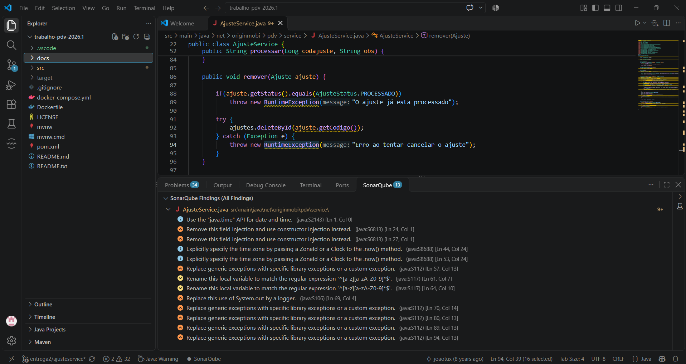
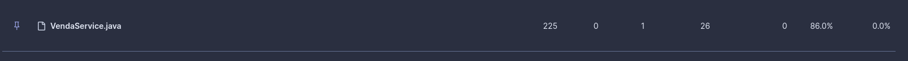
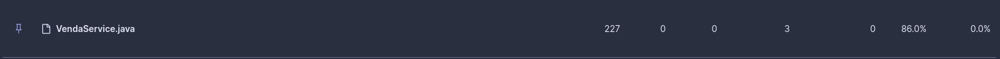

# Inspeção de código (SonarQube for IDE)

Critério da Entrega 2: executar a ferramenta de inspeção, enviar print, resolver
os problemas de ao menos uma classe por integrante e enviar print depois das
correções.

Ferramenta: plugin **SonarQube for IDE** no Eclipse, com as regras padrão
(análise do arquivo pelo menu *SonarQube → Analyze*).

## CaixaService — Eloyse Fernanda

| | Antes | Depois |
| --- | --- | --- |
| Problemas no arquivo | **21** (1 alto, 15 médios, 3 baixos, 2 informativos) | **1** (informativo) |

### Antes


### Depois


### Problemas corrigidos

| Regra apontada pelo Sonar | Qtd | Correção |
| --- | --- | --- |
| Complexidade cognitiva 24 > 15 em `cadastro` | 1 | descrição padrão e observação de abertura extraídas para métodos com `switch` (`descricaoOuPadrao`, `observacaoAbertura`) |
| Ternário aninhado | 1 | substituído por `switch` |
| `if` aninhados que podem ser unidos | 2 | método `temData(String)` em `listarCaixas` e `listaBancosAbertosTipoFilterBanco` |
| Injeção por campo (`@Autowired`) | 3 | injeção por construtor, com campos `final` |
| Variável local esconde o campo `usuario` | 1 | os campos `descricao` e `usuario` viraram variáveis locais, o que também evita estado compartilhado entre requisições num bean singleton |
| Campo `usuario` deveria ser variável local | 1 | idem |
| Exceção genérica (`RuntimeException`) | 6 | nova `CaixaException` (subclasse de `RuntimeException`), com as mesmas mensagens |
| Uso de `System.out` | 2 | removidos (eram impressões de depuração) |
| Retorno por variável temporária | 1 | retorno direto em `buscaCaixaUsuario` |
| Ternário com condição negada | 1 | verificação de `null` direta no valor total do fechamento |
| `.now()` sem fuso horário | 1 | `LocalDate.now(ZONA)`, com `ZONA = America/Sao_Paulo` |

### Problema mantido (justificado)

**"Use the java.time API for date and time"** (informativo). A entidade `Caixa`
exige `java.sql.Date` em `setData_cadastro` e `java.sql.Timestamp` em
`setData_fechamento`. O serviço já calcula as datas com `java.time`
(`LocalDate`, `Instant`, `ZoneId`) e só converte para os tipos antigos ao
preencher a entidade. Zerar o item exigiria alterar a entidade, o mapeamento
JPA, as telas e as consultas do repositório — uma mudança de modelo de dados
fora do escopo da classe sob teste e que não deve ser feita só por causa da
inspeção.

### Efeitos das correções

- **Dois defeitos corrigidos** em `fechaCaixa`, encontrados por leitura do
  código na Entrega 2 (registrados como adiados no AI-012) e resolvidos junto
  com a refatoração:
  - senha `null` lançava `NullPointerException` → agora retorna
    "Favor, informe a senha";
  - caixa inexistente lançava `NoSuchElementException` → agora lança
    `CaixaException("Caixa não encontrado")`.

  Cada um ganhou um teste em `CaixaServiceTest`.
- **Testes:** 43 casos, 0 falhas.
- **Cobertura todas-arestas (JaCoCo):** 97,7% (43/44) → 100% (38/38). O total
  de arestas diminuiu porque os `if` aninhados e os ternários foram
  simplificados; a aresta inalcançável do `else if (BANCO)` deixou de existir.
- **Escore de mutação (PIT):** 96% (52/54) → 100% (55/55). Os dois mutantes
  sobreviventes eram as remoções dos `System.out`, que não existem mais.


## AjusteService — Natalia de Abreu Lamas

| | Antes | Depois |
| --- | --- | --- |
| Problemas no arquivo | **13** (8 médios, 2 baixos, 3 informativos) | **1** (informativo) |

Ferramenta: extensão **SonarQube for IDE** no VS Code, com as regras padrão.

### Antes



### Depois


### Problemas corrigidos

| Regra apontada pelo Sonar | Qtd | Correção |
| --- | --- | --- |
| Injeção por campo (`@Autowired`) — java:S6813 | 2 | injeção por construtor, com campos `final` |
| Exceção genérica (`RuntimeException`) — java:S112 | 5 | nova `AjusteException` (subclasse de `RuntimeException`), com as mesmas mensagens |
| Nome de variável fora do padrão — java:S117 | 2 | `qtd_alteracao` → `qtdAlteracao`; `origem_operacao` → `origemOperacao` |
| Uso de `System.out` — java:S106 | 1 | substituído por logger (`LOG.error`), registrando produto, ajuste e exceção |
| `.now()` sem fuso horário — java:S8688 | 2 | `LocalDate.now(ZONA)`, com `ZONA = America/Sao_Paulo` |

### Problema mantido (justificado)

**"Use the java.time API for date and time"** (informativo). A entidade `Ajuste`
exige `java.sql.Date` em `setData_processamento` e no construtor
(`data_cadastro`). O serviço já calcula as datas com `java.time` (`LocalDate`,
`ZoneId`) e só converte para o tipo antigo ao preencher a entidade. Zerar o item
exigiria alterar a entidade, o mapeamento JPA e as telas — mesma justificativa
adotada em `CaixaService`.

### Efeitos das correções

- **Comportamento preservado:** as mensagens de erro são as mesmas e
  `AjusteException` é subclasse de `RuntimeException`, então o contrato com o
  controller não mudou. Os 19 casos de `AjusteServiceTest` foram executados
  novamente com o mesmo resultado (1 falha intencional, do teste
  `@Tag("defeito")`).
- **Cobertura todas-arestas (JaCoCo):** mantida em 100% (10/10)
  ([relatório](../cobertura-jacoco/)).
- **Escore de mutação (PIT):** 94% (17/18) → 100% (17/17). O mutante
  sobrevivente era a remoção do `System.out.println(e)`, que não existe mais
  ([relatório](../mutacao-pit/)).
- **Defeito não corrigido:** `processar` com código de ajuste inexistente
  continua lançando `NoSuchElementException`. Não foi apontado pelo Sonar e está
  registrado em issue, documentado pelo teste `@Tag("defeito")`.
## VendaService — Alexandre Porto

| | Antes | Depois |
| --- | --- | --- |
| Problemas no arquivo | **26** (1 alto, 19 médios, 5 baixos, 1 informativo) | **3** (2 médios, 1 informativo) |

Ferramenta: **SonarQube Community Build 26.11** em contêiner Docker, com o perfil
`Sonar way comprehensive` (608 regras) e análise pelo `sonar-scanner-cli`. É uma
ferramenta diferente do plugin de IDE usado nas outras classes, então a contagem
não é comparável número a número com a delas. O mesmo arquivo foi analisado antes
e depois, com a mesma ferramenta e o mesmo perfil.

### Antes




Leitura da linha, na ordem das colunas da legenda: 225 linhas de código, 0
problemas de segurança, 1 de confiabilidade, **26 de manutenibilidade**, 0
*security hotspots*, 86,0% de cobertura e 0,0% de duplicação.

### Depois




Mesma legenda do antes: 227 linhas de código, 0 de segurança, **0 de
confiabilidade**, **3 de manutenibilidade**, 0 *security hotspots*, 86,0% de
cobertura e 0,0% de duplicação.

### Problemas corrigidos

| Regra apontada pelo Sonar | Qtd | Correção |
| --- | --- | --- |
| Exceção genérica (`RuntimeException`) — java:S112 | 11 | nova `VendaException` (subclasse de `RuntimeException`), com as mesmas mensagens |
| Uso de `System.out` — java:S106 | 3 | substituído por logger (`LOG.error`), registrando a venda e a exceção |
| Nome de variável fora do padrão — java:S117 | 3 | `vl_parcela` → `vlParcela`; `valor_parcela` → `valorParcela` (2 ocorrências) |
| Complexidade cognitiva 22 > 15 em `fechaVenda` — java:S3776 | 1 | ramo à vista (dinheiro e cartão) extraído para `lancaAVista`; a regra deixou de ser apontada |
| Parâmetros não usados — java:S1172 | 2 | removidos `vlprodutos` e `qtdVezes` de `aprazo` e `formaPagar` de `avistaDinheiro` |
| Método com 10 parâmetros — java:S107 | 1 | `aprazo` passou a receber só a parcela e o prazo da posição atual (`vlParcela`, `prazo`), em vez dos arrays e do índice: 7 parâmetros |
| `Boolean` em vez de `boolean` — java:S5411 | 1 | `vendaIsAberta` devolve `boolean` |
| Campo que nunca é reatribuído — java:S9438 | 1 | `dataHoraAtual` passou a `final` |

A variável `qtdVezes` era código morto: `avistaDinheiro` a decrementava e a
devolvia, mas nenhum trecho lia o resultado. Ela saiu junto com o parâmetro que o
Sonar apontou, e `avistaDinheiro` passou a ser `void`.

### Problemas mantidos (justificados)

**"Parameters to `aprazo` / `avistaDinheiro` have the same names but not the same
order as the method arguments" — java:S2234 (2 ocorrências).** O Sonar encontrou,
sozinho, o defeito **DEF-VENDA-003**
([ficha](../../defeitos/DEF-VENDA-003-desconto-acrescimo-trocados.md),
[issue #13](https://github.com/elojas2/trabalho-pdv-2026.1/issues/13)):
`fechaVenda` passa `desc, acre` a métodos que declaram `acre, desc`, e por isso
desconto e acréscimo são aplicados trocados. O alerta só some corrigindo o
defeito. Como o objetivo do trabalho é que os testes apontem os defeitos, a troca
foi preservada de propósito.

**"Use the java.time API for date and time" — java:S2143 (informativo).** A
entidade `Venda` exige `java.sql.Timestamp` em `setData_cadastro` e
`setData_finalizado`. Zerar o item exigiria alterar a entidade, o mapeamento JPA e
as consultas do repositório, mesma justificativa adotada em `CaixaService` e
`AjusteService`.

### Efeitos das correções

- **Comportamento preservado:** `VendaException` é subclasse de `RuntimeException`
  e as mensagens são as mesmas, então o contrato com o controller e o rollback da
  transação não mudaram.
- **Testes:** `VendaServiceTest` foi executado antes e depois com o mesmo
  resultado (43 casos, 2 falhas intencionais, dos testes `@Tag("defeito")`), e
  `VendaServiceIT` seguiu com 4 de 4 verdes.
- **Cobertura todas-arestas (JaCoCo):** mantida em 89,5% (34/38)
  ([relatório](../cobertura-jacoco/)). A coluna *Coverage* do painel (86,0%)
  coincide com (107 linhas + 34 arestas) / (126 + 38) do JaCoCo, nos dois prints.
- **Escore de mutação (PIT):** 91% (60/66) → 98% (62/63). Nenhum teste foi
  alterado: o logger e a remoção de `qtdVezes` retiraram 5 mutantes da conta
  ([relatório](../mutacao-pit/)).
- **Defeitos não corrigidos:** além da troca de desconto e acréscimo (S2234),
  seguem como estavam os `catch` que engolem exceção em `abreVenda` e `addProduto`
  (issues [#7](https://github.com/elojas2/trabalho-pdv-2026.1/issues/7) e
  [#8](https://github.com/elojas2/trabalho-pdv-2026.1/issues/8)), o retorno
  `"ok"` de `removeProduto` em venda fechada
  ([#9](https://github.com/elojas2/trabalho-pdv-2026.1/issues/9)), o fechamento da
  venda dentro do laço de pagamento
  ([#10](https://github.com/elojas2/trabalho-pdv-2026.1/issues/10)) e a soma das
  parcelas à vista com o índice errado. O Sonar não aponta estes cinco.

### Como reproduzir

```sh
docker run -d --name sonarqube-local -p 9000:9000 sonarqube:community
docker compose exec pdv-app mvn -DskipTests compile
docker run --rm --network host -v "$PWD":/usr/src:ro \
  -e SONAR_HOST_URL=http://localhost:9000 -e SONAR_TOKEN=<token> \
  sonarsource/sonar-scanner-cli \
  -Dsonar.projectKey=pdv -Dsonar.sources=src/main/java \
  -Dsonar.java.binaries=target/classes -Dsonar.java.source=8 \
  -Dsonar.working.directory=/tmp/scannerwork -Dsonar.scm.disabled=true
```

Antes de analisar, associar ao projeto o perfil `Sonar way comprehensive`
(*Quality Profiles*). O perfil padrão do servidor, `Sonar way core`, tem só 263
regras e não aponta nenhum problema nesta classe.
