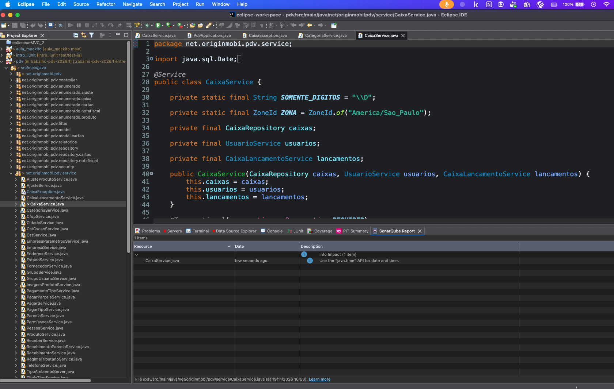

# Inspeção de código (SonarQube for IDE)

Critério da Entrega 2: executar a ferramenta de inspeção, enviar print, resolver
os problemas de ao menos uma classe por integrante e enviar print depois das
correções.

Ferramenta: plugin **SonarQube for IDE** no Eclipse, com as regras padrão
(análise do arquivo pelo menu *SonarQube → Analyze*).

## CaixaService — Eloyse Fernanda

| | Antes | Depois |
| --- | --- | --- |
| Problemas no arquivo | **21** (1 alto, 15 médios, 3 baixos, 2 informativos) | **1** (informativo) |

### Antes

### Depois

### Problemas corrigidos

| Regra apontada pelo Sonar | Qtd | Correção |
| --- | --- | --- |
| Complexidade cognitiva 24 > 15 em `cadastro` | 1 | descrição padrão e observação de abertura extraídas para métodos com `switch` (`descricaoOuPadrao`, `observacaoAbertura`) |
| Ternário aninhado | 1 | substituído por `switch` |
| `if` aninhados que podem ser unidos | 2 | método `temData(String)` em `listarCaixas` e `listaBancosAbertosTipoFilterBanco` |
| Injeção por campo (`@Autowired`) | 3 | injeção por construtor, com campos `final` |
| Variável local esconde o campo `usuario` | 1 | os campos `descricao` e `usuario` viraram variáveis locais, o que também evita estado compartilhado entre requisições num bean singleton |
| Campo `usuario` deveria ser variável local | 1 | idem |
| Exceção genérica (`RuntimeException`) | 6 | nova `CaixaException` (subclasse de `RuntimeException`), com as mesmas mensagens |
| Uso de `System.out` | 2 | removidos (eram impressões de depuração) |
| Retorno por variável temporária | 1 | retorno direto em `buscaCaixaUsuario` |
| Ternário com condição negada | 1 | verificação de `null` direta no valor total do fechamento |
| `.now()` sem fuso horário | 1 | `LocalDate.now(ZONA)`, com `ZONA = America/Sao_Paulo` |

### Problema mantido (justificado)

**"Use the java.time API for date and time"** (informativo). A entidade `Caixa`
exige `java.sql.Date` em `setData_cadastro` e `java.sql.Timestamp` em
`setData_fechamento`. O serviço já calcula as datas com `java.time`
(`LocalDate`, `Instant`, `ZoneId`) e só converte para os tipos antigos ao
preencher a entidade. Zerar o item exigiria alterar a entidade, o mapeamento
JPA, as telas e as consultas do repositório — uma mudança de modelo de dados
fora do escopo da classe sob teste e que não deve ser feita só por causa da
inspeção.

### Efeitos das correções

- **Dois defeitos corrigidos** em `fechaCaixa`, encontrados por leitura do
  código na Entrega 2 (registrados como adiados no AI-012) e resolvidos junto
  com a refatoração:
  - senha `null` lançava `NullPointerException` → agora retorna
    "Favor, informe a senha";
  - caixa inexistente lançava `NoSuchElementException` → agora lança
    `CaixaException("Caixa não encontrado")`.

  Cada um ganhou um teste em `CaixaServiceTest`.
- **Testes:** 43 casos, 0 falhas.
- **Cobertura todas-arestas (JaCoCo):** 97,7% (43/44) → 100% (38/38). O total
  de arestas diminuiu porque os `if` aninhados e os ternários foram
  simplificados; a aresta inalcançável do `else if (BANCO)` deixou de existir.
- **Escore de mutação (PIT):** 96% (52/54) → 100% (55/55). Os dois mutantes
  sobreviventes eram as remoções dos `System.out`, que não existem mais.
