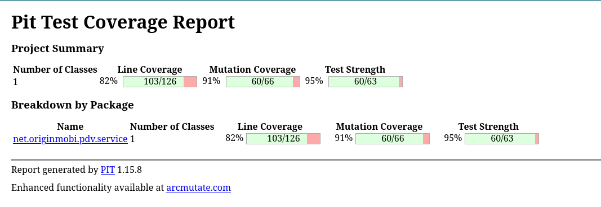

# Teste de mutação (PIT)

Critério da Entrega 2: escore de mutação ≥ 80% nas mesmas classes do teste
estrutural.

## CaixaService — Eloyse Fernanda

| Métrica | Resultado |
| --- | --- |
| **Escore de mutação** | **96%** (52 de 54 mutantes mortos) |
| Cobertura de linhas | 100% (80/80) |
| Mutantes sem cobertura | 0 |


### Mutantes sobreviventes

| Linha | Mutação | Análise |
| --- | --- | --- |
| 73 | remoção de `System.out.println("agencia " + ...)` | equivalente |
| 74 | remoção de `System.out.println("conta " + ...)` | equivalente |

Relatório completo do PIT para a classe, com o código linha a linha (verde:
mutante morto; vermelho: sobrevivente) e a lista de todos os mutantes no final:
[`pit-caixaservice-relatorio.pdf`](pit-caixaservice-relatorio.pdf).

Os dois são impressões de depuração esquecidas no método `cadastro`, sem efeito
nas regras de negócio: removê-las não muda nenhum valor salvo nem retornado.
Escrever um teste que capture a saída do console só para matá-los seria
artificial, por isso foram tratados como **mutantes equivalentes**. As duas
linhas serão removidas na etapa de inspeção com o SonarQube, que também aponta
o uso de `System.out` como problema de qualidade.

### Como reproduzir

```sh
JAVA_HOME=$(/usr/libexec/java_home -v 1.8) mvn test-compile \
  org.pitest:pitest-maven:mutationCoverage \
  -DtargetClasses=net.originmobi.pdv.service.CaixaService \
  -DtargetTests=net.originmobi.pdv.CaixaServiceTest
```

O relatório completo, com o detalhe linha a linha, é gerado em
`target/pit-reports/index.html`. PIT 1.15.8 com
`pitest-junit5-plugin` 1.2.1, mutadores padrão (`DEFAULTS`).

## VendaService — Alexandre Porto

| Métrica | Resultado |
| --- | --- |
| **Escore de mutação** | **91%** (60 de 66 mutantes mortos) |
| Test strength | 95% (60/63) |
| Cobertura de linhas | 82% (103/126) |
| Mutantes sem cobertura | 3 |



Resumo do PIT (PDF): [`pit-vendaservice-resumo.pdf`](pit-vendaservice-resumo.pdf).

> **Nota sobre os testes de defeito.** `VendaServiceTest` contém 2 testes que
> falham de propósito, documentando defeitos do código legado (exceção
> silenciada em `abreVenda` e em `addProduto`). Como o PIT exige uma suíte verde
> ("Mutation testing requires a green suite"), esses testes foram marcados com
> `@Tag("defeito")` e **excluídos apenas da medição de mutação** (via
> `<excludedGroups>` no `pom.xml`). Eles permanecem no `mvn test` e no JaCoCo
> como evidência. **Nenhum defeito do código foi corrigido.**

### Mutantes sobreviventes

| Linha | Método | Mutação | Análise |
| --- | --- | --- | --- |
| 179 | `fechaVenda` | negação da condição do `for` que preenche `modeloPagar` | equivalente |
| 193 | `fechaVenda` | remoção de `System.out.println(e)` (bloco `catch`) | equivalente |
| 242 | `fechaVenda` | remoção de `System.out.println(e)` (bloco `catch`) | equivalente |
| 290 | `avistaDinheiro` | `qtdVezes = qtdVezes - 1` → `+` | sem efeito observável |
| 316 | `avistaDinheiro` | remoção de `System.out.println(e)` (bloco `catch`) | equivalente |
| 319 | `avistaDinheiro` | `return qtdVezes` → `return 0` | sem efeito observável |

Relatório completo do PIT para a classe, com o código linha a linha (verde:
mutante morto; vermelho: sobrevivente) e a lista de todos os mutantes:
[`pit-vendaservice-relatorio.pdf`](pit-vendaservice-relatorio.pdf).

Os 6 sobreviventes são **equivalentes** ou **sem efeito observável**:

- **L193, L242, L316** — `System.out.println(e)` dentro de blocos `catch`.
  Mesma situação dos equivalentes de `CaixaService`: não alteram valor salvo nem
  retornado; matá-los exigiria capturar o console artificialmente. Serão
  apontados pelo SonarQube como problema de qualidade (uso de `System.out`).
- **L179** — negar a condição do laço `for (i < formaPagar.length)` só muda o
  preenchimento do `HashMap modeloPagar`, que o código **cria e nunca consome**
  (o próprio comentário do código indica uma intenção não implementada). Sem
  saída observável, é um mutante equivalente genuíno (código morto).
- **L290 e L319** — o valor `qtdVezes` retornado por `avistaDinheiro` é
  reatribuído no chamador, mas não influencia nenhuma saída observável no fluxo
  exercitável; mutá-lo não produz diferença detectável.

### Como reproduzir

Execução via container Docker (Maven 3.8 + JDK 8):

```sh
docker compose up -d
docker compose exec pdv-app mvn test-compile \
  org.pitest:pitest-maven:mutationCoverage \
  -DtargetClasses=net.originmobi.pdv.service.VendaService \
  -DtargetTests=net.originmobi.pdv.VendaServiceTest
```

O relatório completo, com o detalhe linha a linha, é gerado em
`target/pit-reports/index.html`. PIT 1.15.8 com `pitest-junit5-plugin` 1.2.1,
mutadores padrão (`DEFAULTS`). Os testes `@Tag("defeito")` são excluídos da
medição pela configuração `<excludedGroups>` do `pitest-maven` no `pom.xml`.
