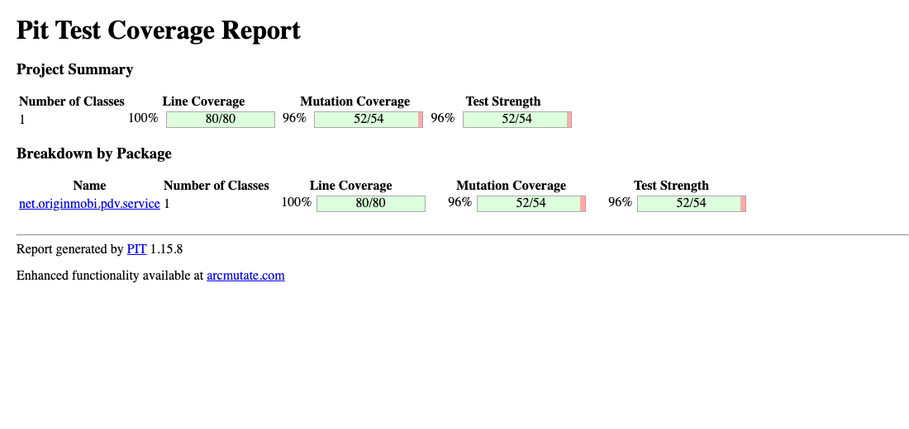

# Teste de mutação (PIT)

Critério da Entrega 2: escore de mutação ≥ 80% nas mesmas classes do teste
estrutural.

## CaixaService — Eloyse Fernanda

| Métrica | Resultado |
| --- | --- |
| **Escore de mutação** | **96%** (52 de 54 mutantes mortos) |
| Cobertura de linhas | 100% (80/80) |
| Mutantes sem cobertura | 0 |



### Mutantes sobreviventes

| Linha | Mutação | Análise |
| --- | --- | --- |
| 73 | remoção de `System.out.println("agencia " + ...)` | equivalente |
| 74 | remoção de `System.out.println("conta " + ...)` | equivalente |

Trecho do relatório do PIT no método `cadastro`: as linhas em verde tiveram os
mutantes mortos pelos testes; as duas em vermelho são os sobreviventes.


Relatório completo do PIT para a classe, com o código linha a linha e a lista
de todos os mutantes no final:
[`pit-caixaservice-relatorio.pdf`](pit-caixaservice-relatorio.pdf).

Os dois são impressões de depuração esquecidas no método `cadastro`, sem efeito
nas regras de negócio: removê-las não muda nenhum valor salvo nem retornado.
Escrever um teste que capture a saída do console só para matá-los seria
artificial, por isso foram tratados como **mutantes equivalentes**. As duas
linhas serão removidas na etapa de inspeção com o SonarQube, que também aponta
o uso de `System.out` como problema de qualidade.

### Como reproduzir

```sh
JAVA_HOME=$(/usr/libexec/java_home -v 1.8) mvn test-compile \
  org.pitest:pitest-maven:mutationCoverage \
  -DtargetClasses=net.originmobi.pdv.service.CaixaService \
  -DtargetTests=net.originmobi.pdv.CaixaServiceTest
```

O relatório completo, com o detalhe linha a linha, é gerado em
`target/pit-reports/index.html`. PIT 1.15.8 com
`pitest-junit5-plugin` 1.2.1, mutadores padrão (`DEFAULTS`).
