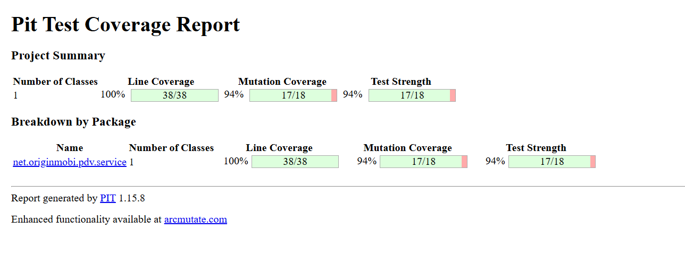

# Teste de mutação (PIT)

Critério da Entrega 2: escore de mutação ≥ 80% nas mesmas classes do teste
estrutural.

## CaixaService — Eloyse Fernanda

| Métrica | Resultado |
| --- | --- |
| **Escore de mutação** | **100%** (55 de 55 mutantes mortos) |
| Test strength | 100% (55/55) |
| Cobertura de linhas | 100% (80/80) |
| Mutantes sem cobertura | 0 |


Relatório completo do PIT para a classe, com o código linha a linha (verde:
mutante morto; vermelho: sobrevivente) e a lista de todos os mutantes no final:
[`pit-caixaservice-relatorio.pdf`](pit-caixaservice-relatorio.pdf).

### Evolução: 96% → 100%

| Rodada | Mutantes | Mortos | Escore | Sobreviventes |
| --- | --- | --- | --- | --- |
| 1ª (08/11, antes do Sonar) | 54 | 52 | 96% | 2 |
| 2ª (19/11, depois do Sonar) | 55 | 55 | **100%** | 0 |

Na 1ª rodada sobreviveram 2 mutantes, nas linhas 73 e 74 de `cadastro`: a
remoção dos `System.out.println("agencia " + ...)` e
`System.out.println("conta " + ...)`. Eram impressões de depuração sem efeito
nas regras de negócio — removê-las não mudava nenhum valor salvo nem retornado.
Escrever um teste que capturasse a saída do console só para matá-los seria
artificial, por isso foram classificados como **mutantes equivalentes**.

Na etapa de inspeção ([relatório do Sonar](../inspecao-sonar/)), o SonarQube
apontou o uso de `System.out` e as duas linhas foram removidas. Com isso os
mutantes equivalentes deixaram de existir. A refatoração da classe mudou o
total de mutantes gerados (54 → 55), e todos foram mortos pela suíte de 43
casos.

### Como reproduzir

```sh
JAVA_HOME=$(/usr/libexec/java_home -v 1.8) mvn test-compile \
  org.pitest:pitest-maven:mutationCoverage \
  -DtargetClasses=net.originmobi.pdv.service.CaixaService \
  -DtargetTests=net.originmobi.pdv.CaixaServiceTest
```

O relatório completo, com o detalhe linha a linha, é gerado em
`target/pit-reports/index.html`. PIT 1.15.8 com
`pitest-junit5-plugin` 1.2.1, mutadores padrão (`DEFAULTS`).

## VendaService — Alexandre Porto

| Métrica | Resultado |
| --- | --- |
| **Escore de mutação** | **98%** (62 de 63 mutantes mortos) |
| Test strength | 98% (62/63) |
| Cobertura de linhas | 82% (103/126) |
| Mutantes sem cobertura | 0 |


Resumo do PIT (PDF): [`pit-vendaservice-resumo.pdf`](pit-vendaservice-resumo.pdf).

> **Nota sobre os testes de defeito.** `VendaServiceTest` contém 2 testes que
> falham de propósito, documentando defeitos do código legado (exceção
> silenciada em `abreVenda` e em `addProduto`). Como o PIT exige uma suíte verde
> ("Mutation testing requires a green suite"), esses testes foram marcados com
> `@Tag("defeito")` e **excluídos apenas da medição de mutação** (via
> `<excludedGroups>` no `pom.xml`). Eles permanecem no `mvn test` e no JaCoCo
> como evidência. **Nenhum defeito do código foi corrigido.**

### Evolução: 65% → 91% → 98%

| Rodada | Mutantes | Mortos | Escore | Sobreviventes |
| --- | --- | --- | --- | --- |
| 1ª (09/11, suíte da Entrega 1) | 66 | 43 | 65% | 23 |
| 2ª (09/11, suíte ampliada com 9 casos) | 66 | 60 | 91% | 6 |
| 3ª (23/11, depois do Sonar) | 63 | 62 | **98%** | 1 |

Da 1ª para a 2ª rodada o ganho veio de testes novos, com `ArgumentCaptor` para
conferir valores calculados e retornados. Da 2ª para a 3ª, **nenhum teste foi
alterado**: o escore subiu porque a refatoração do Sonar
([relatório](../inspecao-sonar/)) tirou 5 mutantes da conta.

- **3 mutantes de `System.out.println(e)`** (L193, L242 e L316 na 2ª rodada):
  o Sonar apontou o uso de `System.out` e as linhas passaram a usar um logger
  (`LOG.error`). O PIT não gera mutantes para chamadas de log, então eles
  deixaram de existir. Não foram "mortos" por teste.
- **2 mutantes de `qtdVezes`** (L290 e L319 na 2ª rodada): a variável era
  código morto (era decrementada e devolvida, mas ninguém lia o resultado). O
  Sonar apontou o parâmetro não usado, e a variável foi removida junto.

### Mutante sobrevivente

| Linha | Método | Mutação | Análise |
| --- | --- | --- | --- |
| 181 | `fechaVenda` | negação da condição do `for` que preenche `modeloPagar` | equivalente |

O laço preenche um `HashMap modeloPagar` que o código **cria e nunca consome**
(o comentário original indica uma intenção não implementada). Negar a condição
do laço só muda o conteúdo desse mapa, sem nenhuma saída observável. É código
morto e o Sonar não o apontou, por isso foi mantido: remover o laço seria uma
mudança fora do que a inspeção pediu.

Relatório completo do PIT para a classe, com o código linha a linha (verde:
mutante morto; vermelho: sobrevivente) e a lista de todos os mutantes:
[`pit-vendaservice-relatorio.pdf`](pit-vendaservice-relatorio.pdf).

### Como reproduzir

Execução via container Docker (Maven 3.8 + JDK 8):

```sh
docker compose up -d
docker compose exec pdv-app mvn test-compile \
  org.pitest:pitest-maven:mutationCoverage \
  -DtargetClasses=net.originmobi.pdv.service.VendaService \
  -DtargetTests=net.originmobi.pdv.VendaServiceTest
```

O relatório completo, com o detalhe linha a linha, é gerado em
`target/pit-reports/index.html`. PIT 1.15.8 com `pitest-junit5-plugin` 1.2.1,
mutadores padrão (`DEFAULTS`). Os testes `@Tag("defeito")` são excluídos da
medição pela configuração `<excludedGroups>` do `pitest-maven` no `pom.xml`.

## AjusteService — Natalia de Abreu Lamas

| Métrica | Resultado |
| --- | --- |
| **Escore de mutação** | **100%** (17 de 17 mutantes mortos) |
| Test strength | 100% (17/17) |
| Cobertura de linhas | 100% (43/43) |
| Mutantes sem cobertura | 0 |



Relatório completo do PIT para a classe, com o código linha a linha (verde:
mutante morto; vermelho: sobrevivente) e a lista de todos os mutantes no final:
[`pit-ajusteservice-relatorio.pdf`](pit-ajusteservice-relatorio.pdf).

> **Nota sobre o teste de defeito.** `AjusteServiceTest` contém 1 teste que
> falha de propósito, documentando que `processar` lança
> `NoSuchElementException` quando o código do ajuste não existe. Ele é marcado
> com `@Tag("defeito")` e excluído apenas da medição de mutação, pois o PIT
> exige uma suíte verde.

### Evolução: 94% → 100%

| Rodada | Mutantes | Mortos | Escore | Sobreviventes |
| --- | --- | --- | --- | --- |
| 1ª (21/11, antes do Sonar) | 18 | 17 | 94% | 1 |
| 2ª (21/11, depois do Sonar) | 17 | 17 | **100%** | 0 |

Na 1ª rodada sobreviveu 1 mutante, na linha 69 de `processar`: a remoção do
`System.out.println(e)` dentro do bloco `catch`. A linha apenas imprimia a
exceção no console — removê-la não alterava o ajuste gravado, a mensagem da
exceção lançada nem o retorno do método — por isso foi classificada como
**mutante equivalente**.

Na etapa de inspeção ([relatório do Sonar](../inspecao-sonar/)), o SonarQube
apontou o uso de `System.out` e a linha foi substituída por um logger
(`LOG.error`). O PIT não gera mutantes para chamadas de log, então o mutante
equivalente deixou de existir e todos os 17 restantes foram mortos pela suíte
de 19 casos.

### Como reproduzir

Execução via container Docker (Maven 3.8 + JDK 8):

```sh
docker run --rm -v "${PWD}:/app" -v pdv-m2:/root/.m2 -w /app maven:3.8.8-eclipse-temurin-8 mvn test-compile org.pitest:pitest-maven:mutationCoverage "-DtargetClasses=net.originmobi.pdv.service.AjusteService" "-DtargetTests=net.originmobi.pdv.AjusteServiceTest"
```

Relatório em `target/pit-reports/index.html`. PIT 1.15.8 com
`pitest-junit5-plugin` 1.2.1, mutadores padrão (`DEFAULTS`).