# Relatório de Testes Manuais — AjusteService

**Módulo:** Estoque (Ajuste de Estoque)
**Classe sob teste:** `net.originmobi.pdv.service.AjusteService`
**Funcionalidade:** Processamento e validação de remoção de Ajuste de Estoque
**Responsável:** Natalia de Abreu Lamas
**Data de execução:** 21/11/2026
**Ambiente:** Docker (MySQL 8.0 e aplicação em containers na mesma rede), aplicação em <http://localhost:8080>, usuário `gerente`

> Técnica: teste funcional (caixa-preta), nível de sistema, executado pela
> interface web. Os resultados esperados refletem a **regra de negócio**, não o
> comportamento atual do código; divergências são registradas como defeitos.

## Pré-condições gerais

- Ambiente no ar e login efetuado com o usuário `gerente`.
- Produto **Picolé** (código 1, "Controla estoque = SIM") da carga inicial do
  banco, com saldo **0** no início da execução.
- Os casos são executados na ordem abaixo: o saldo final de um caso é o saldo
  inicial do seguinte.

## Resumo da execução

| ID | Cenário | Status | Defeito |
| --- | --- | --- | --- |
| CT-AJU-01 | Processar ajuste de entrada (+10) | Falhou | [#14](https://github.com/elojas2/trabalho-pdv-2026.1/issues/14) |
| CT-AJU-02 | Processar ajuste de saída (-3) | Falhou | [#27](https://github.com/elojas2/trabalho-pdv-2026.1/issues/27) |
| CT-AJU-03 | Cancelar ajuste já processado | Passou | — |
| CT-AJU-04 | Cancelar ajuste pendente | Passou | — |

## Casos de teste detalhados

### CT-AJU-01 — Processar ajuste de entrada (+10)

- **Pré-condições:** Picolé com saldo 0.
- **Passos:** Produtos → Ajuste Estoque → Novo → selecionar "COD: 1 - Picolé" →
  Inserir → informar quantidade `10` → Observação "Teste manual entrada" →
  Processar → confirmar.
- **Resultado esperado:** mensagem "Ajuste realizado com sucesso"; ajuste com
  status Processado; saldo do Picolé passa de **0 para 10** (o próprio ajuste
  mostra "Novo Estoque 10").
- **Resultado obtido:** mensagem "Ajuste realizado com sucesso", mas o saldo do
  Picolé continua **0** na lista de produtos.
- **Status:** Falhou.
- **Evidências:**
  - 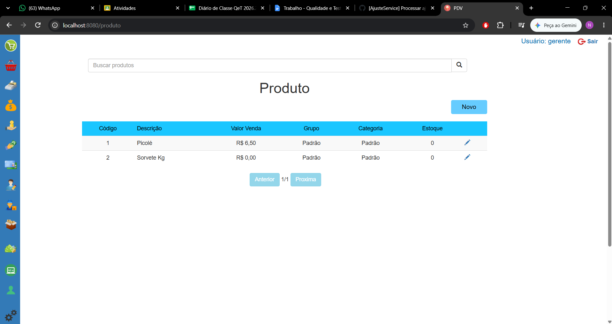
  - 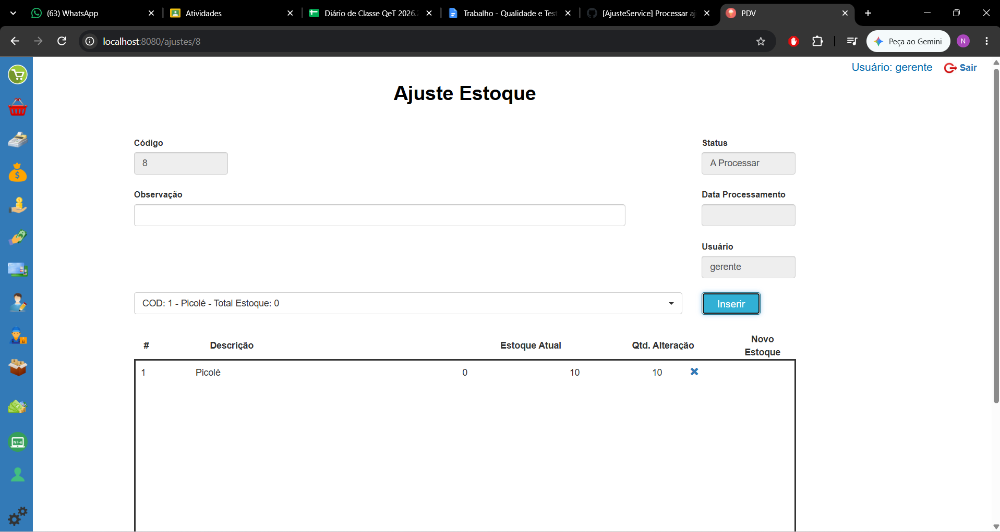
  - 
  - 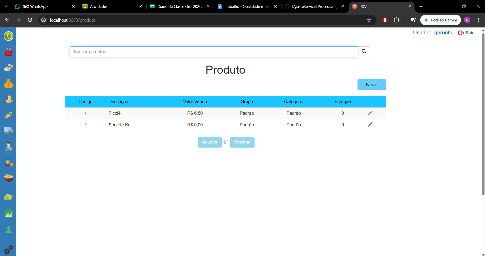

### CT-AJU-02 — Processar ajuste de saída (-3)

- **Pré-condições:** Picolé com saldo 0 (resultado do CT-AJU-01).
- **Passos:** Ajuste Estoque → Novo → selecionar "COD: 1 - Picolé" → Inserir →
  informar quantidade `-3` → Observação "Teste manual saida" → Processar →
  confirmar.
- **Resultado esperado:** uma saída não pode aumentar o saldo — o saldo deveria
  diminuir (ficar -3) ou o sistema deveria recusar a saída por falta de estoque.
- **Resultado obtido:** mensagem "Ajuste realizado com sucesso" e o saldo do
  Picolé **sobe de 0 para 3**.
- **Status:** Falhou.
- **Evidências:**
  - 
  - 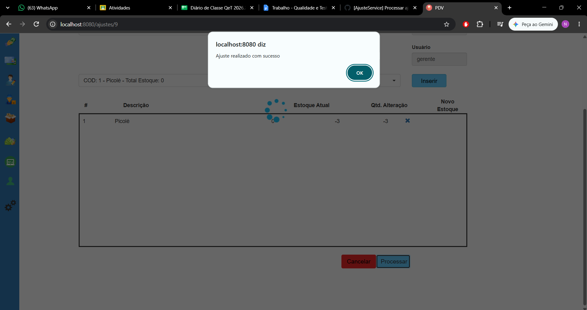
  - 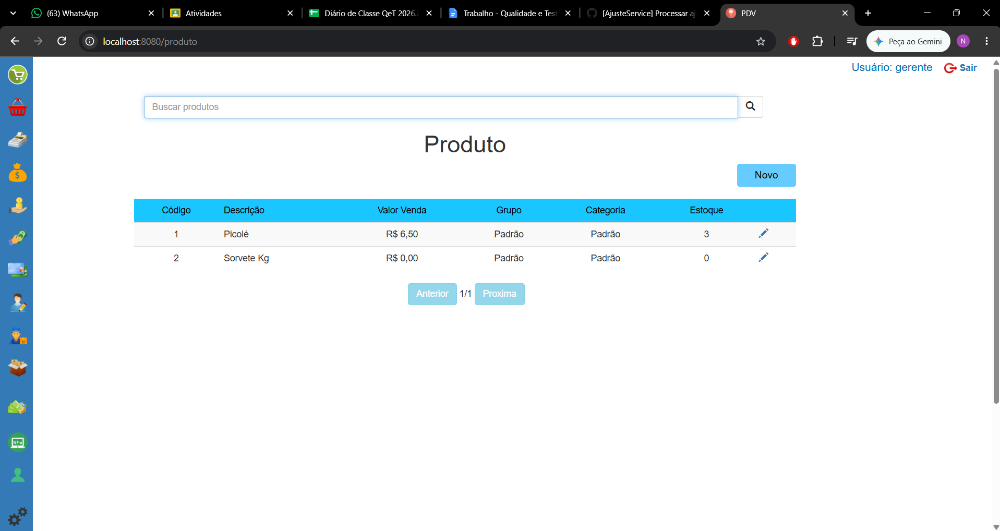

### CT-AJU-03 — Cancelar ajuste já processado

- **Pré-condições:** ajuste com status Processado (o do CT-AJU-02).
- **Passos:** Ajuste Estoque → abrir o ajuste processado → Cancelar → confirmar.
- **Resultado esperado:** o sistema impede o cancelamento com a mensagem
  "O ajuste já esta processado"; o ajuste continua na lista.
- **Resultado obtido:** mensagem "O ajuste já esta processado"; o ajuste não é
  removido.
- **Status:** Passou.
- **Evidências:**
  - 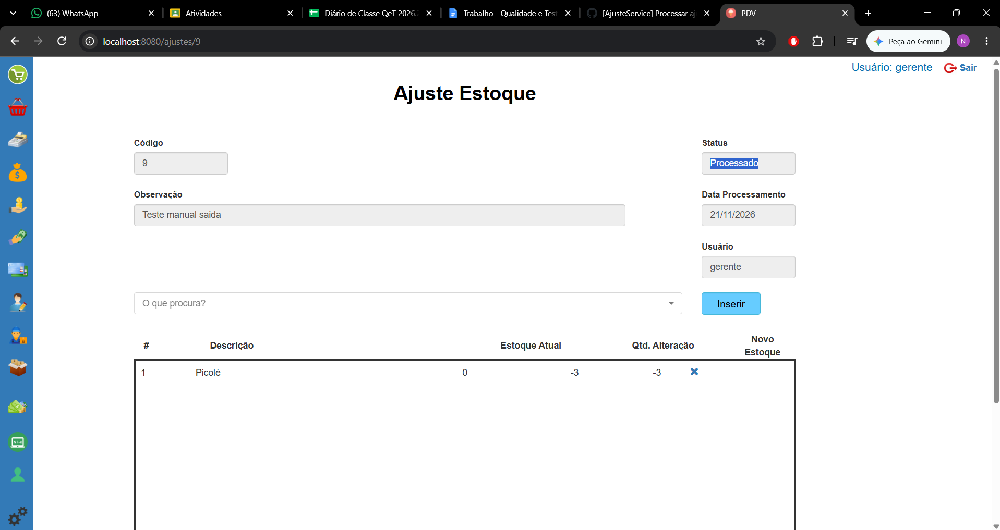
  - 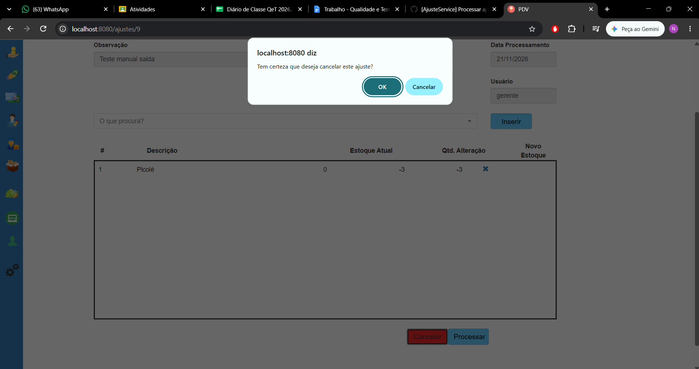
  - 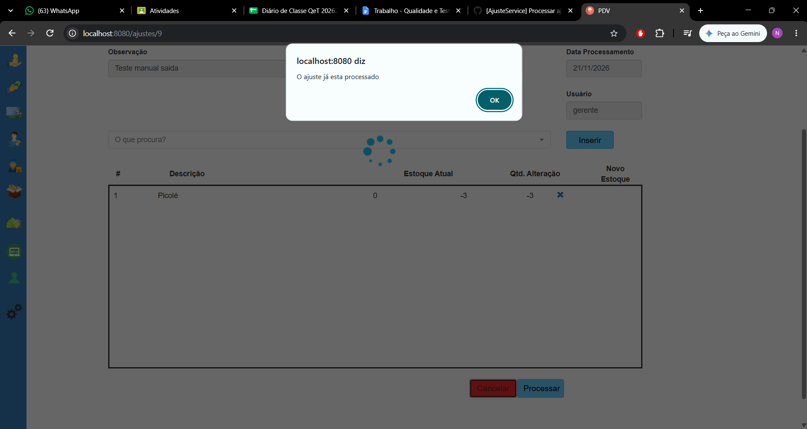

### CT-AJU-04 — Cancelar ajuste pendente

- **Pré-condições:** nenhuma (o ajuste é criado no próprio caso).
- **Passos:** Ajuste Estoque → Novo (ajuste de código 12, status A Processar) →
  voltar à lista → abrir o ajuste 12 → Cancelar → confirmar.
- **Resultado esperado:** o ajuste é excluído e o sistema volta para a lista,
  sem o ajuste 12.
- **Resultado obtido:** o sistema volta para a lista e o ajuste 12 não aparece
  mais.
- **Status:** Passou.
- **Evidências:**
  - 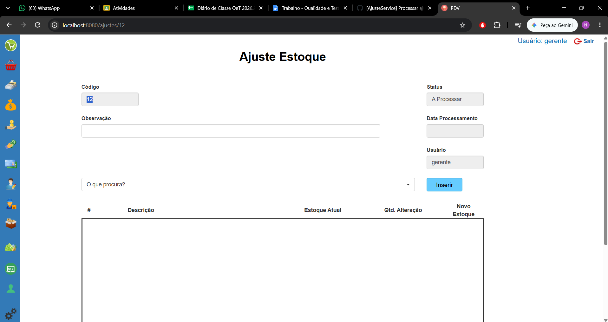
  - 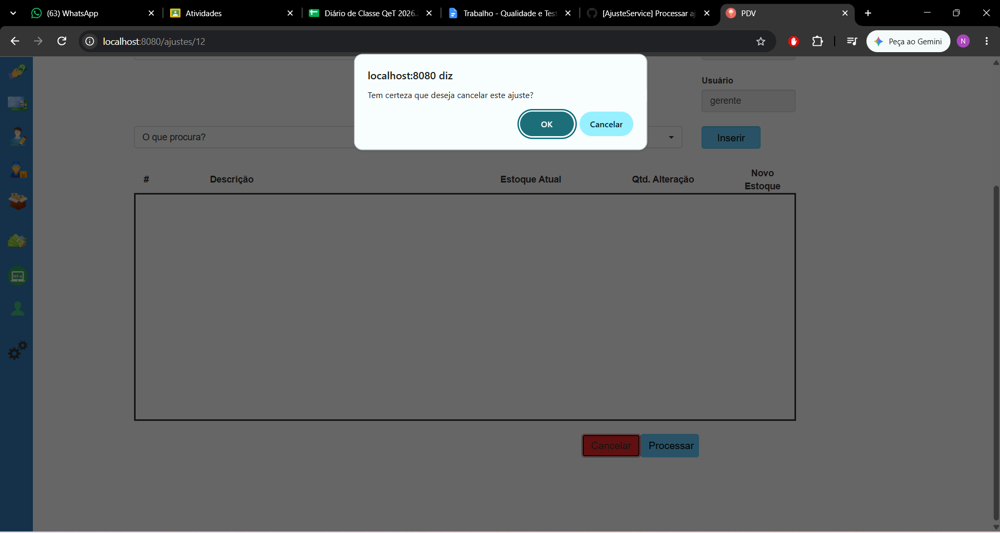
  - 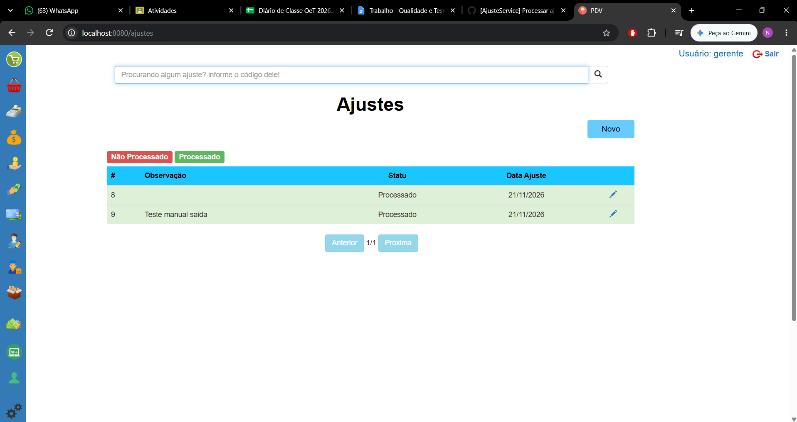

## Relação com os testes automatizados

Os dois defeitos encontrados pela interface já haviam sido apontados pelo teste
de integração [`AjusteServiceIT`](../../src/test/java/net/originmobi/pdv/AjusteServiceIT.java)
(`processar_Entrada_DeveAumentarSaldo` e `processar_Saida_DeveDiminuirSaldo`),
que roda o `AjusteService` contra o banco MySQL real. A causa é o trigger
`atualiza_produto_estoque_AFTER_INSERT`, que sempre calcula
`saldo - quantidade` sem considerar o tipo da movimentação (ENTRADA/SAIDA). As
regras de cancelamento (CT-AJU-03 e CT-AJU-04) correspondem aos dois lados do
`if` de `AjusteService.remover`, também cobertos pelos testes unitários.