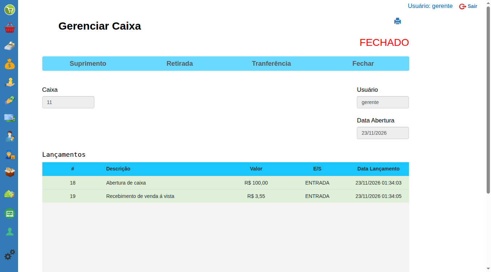

# Testes de sistema (Selenium)

Critério da Entrega 2: implementar testes de sistema considerando requisitos
funcionais, com Selenium.

## VendaService — Alexandre Porto

| Item | Valor |
| --- | --- |
| Ferramenta | Selenium WebDriver 4.13.0 + Chrome (JUnit 5), com o Chrome da imagem `selenium/standalone-chrome` acessado por `RemoteWebDriver` |
| Classe de teste | [`src/test/java/net/originmobi/pdv/sistema/VendaSeleniumIT.java`](../../src/test/java/net/originmobi/pdv/sistema/VendaSeleniumIT.java) |
| Requisitos funcionais | fechar venda à vista (dinheiro e cartão) e a prazo, com desconto e acréscimo, e as validações do fechamento (sem cliente, sem caixa, sem valor, sem estoque) |
| Resultado | **Tests run: 8, Failures: 3** — as 3 falhas são os defeitos [#12](https://github.com/elojas2/trabalho-pdv-2026.1/issues/12), [#13](https://github.com/elojas2/trabalho-pdv-2026.1/issues/13) e [DEF-VENDA-004](../defeitos/DEF-VENDA-004-venda-a-prazo-nao-fecha.md) |

### Cenários

| # | Cenário | Caso manual | Resultado |
| --- | --- | --- | --- |
| 1 | Venda à vista em dinheiro com caixa aberto mostra "Venda finalizada com sucesso", o pedido fica FECHADA com os botões bloqueados e o caixa recebe a entrada de R$ 3,50 | CT-VENDA-01 | Passou |
| 2 | Venda a prazo com cliente fecha | CT-VENDA-04 | **Falhou** — "No message available" em vez de "Venda finalizada com sucesso", [DEF-VENDA-004](../defeitos/DEF-VENDA-004-venda-a-prazo-nao-fecha.md) |
| 3 | Venda a prazo sem cliente mostra "Venda sem cliente, verifique" e o pedido continua ABERTA | CT-VENDA-05 | Passou |
| 4 | Venda à vista em dinheiro sem caixa aberto mostra "nenhum caixa aberto" e o pedido continua ABERTA | CT-VENDA-07 | Passou |
| 5 | Venda sem produtos mostra "Venda sem valor, verifique" e o pedido continua ABERTA | CT-VENDA-08 | Passou |
| 6 | Produto que controla estoque, sem saldo, mostra "O produto de código N não tem estoque suficiente, verifique" e o pedido continua ABERTA | CT-VENDA-10 | Passou |
| 7 | Venda à vista no cartão de débito fecha | CT-VENDA-03 | **Falhou** — "No message available", [#12](https://github.com/elojas2/trabalho-pdv-2026.1/issues/12) |
| 8 | Desconto de 1,00 e acréscimo de 0,95 sobre R$ 3,50 lançam R$ 3,45 no caixa | CT-VENDA-06 | **Falhou** — lançou R$ 3,55, [#13](https://github.com/elojas2/trabalho-pdv-2026.1/issues/13) |

Os cenários 2, 7 e 8 falham de propósito: afirmam a regra de negócio e mostram, pela
interface, defeitos já registrados. Estão marcados com `@Tag("defeito")`.

- **Cenário 7:** o título de cartão criado pela tela fica sem máquina de cartão
  (o campo está comentado no formulário) e o fechamento lança
  `NullPointerException`.
- **Cenário 8:** o valor lançado é `(3,50 + 1,00) − 0,95` = 3,55, pela troca de
  `desc` e `acre`. A venda e o recebível gravam 3,45, certo. O "R$ 3,50" que o
  pedido mostra é o total dos produtos e não revela o defeito; só a tela do caixa
  revela:

  

- **Cenário 2:** defeito novo, encontrado por este teste. O log da aplicação mostra
  `Field 'data_alteracao' doesn't have a default value` no `insert into parcela`:
  no MySQL 8, nenhuma venda a prazo fecha. Detalhes na
  [ficha](../defeitos/DEF-VENDA-004-venda-a-prazo-nao-fecha.md).

Ficaram de fora o caso do pagamento sem título ("Zero length string", [#11](https://github.com/elojas2/trabalho-pdv-2026.1/issues/11)),
que só acontece quando não há nenhum título cadastrado e o ambiente de teste
cadastra os seus, e o cartão de crédito, que passa pelo mesmo caminho do débito.
Os dois seguem cobertos pelos testes manuais.

### O que o nível de sistema verifica

- **Digitação real** com eventos de teclado, inclusive nos campos com máscara de
  dinheiro (digitar `100` vira 1,00 e `95` vira 0,95).
- **Seleção de produto** pela caixa `bootstrap-select` do pedido e **janela de
  pagamento** com forma, parcelas e títulos carregados por AJAX.
- **Alertas do navegador** lidos de verdade: a mensagem que o operador vê.
- **Efeito no sistema:** situação do pedido depois de recarregar a tela (os
  fechamentos recusados desfazem a transação e o pedido continua ABERTA) e a linha
  do lançamento na tela do caixa.

**Massa de dados.** Os dois produtos de teste (um que não controla estoque e um que
controla, com saldo 0) são criados direto no banco por JDBC, uma única vez: o
cadastro de produto pela tela exige fornecedor, categoria e grupo, que não fazem
parte do requisito. Os títulos de pagamento e o caixa são criados pela interface; o
teste fecha o caixa que abriu e, se já houver um caixa aberto, usa esse. O cenário
4 é ignorado (`assumeTrue`) se houver caixa aberto, porque exige nenhum. Não há
rollback: pedidos, títulos e produtos criados ficam no banco.

### Como reproduzir

1. Subir o banco e a aplicação (ver o README da raiz) e conferir que
   <http://localhost:8080> abre a tela de login.
2. Com JDK 8, Maven e Chrome instalados, na raiz do projeto:

   ```sh
   mvn test "-Dtest=VendaSeleniumIT" "-Dmaven.test.failure.ignore=true" "-Dmaven.main.skip=true" "-Dmaven.resources.skip=true"
   ```

   Opcional: `-Dheadless=true`, `-Dpdv.url=...`, `-Dpdv.db.url=...`
   (padrão `jdbc:mysql://localhost:3306/pdv`, usuário `root`).

   **Sem Chrome nem Maven na máquina** (como foi executado): Chrome em contêiner e
   Maven dentro do contêiner `pdv-app`.

   ```sh
   docker run -d --name selenium-chrome --network trabalho-pdv-20261_default \
     --shm-size=2g -p 4444:4444 selenium/standalone-chrome
   docker compose exec pdv-app mvn test -Dtest=VendaSeleniumIT \
     -Dselenium.remote=http://selenium-chrome:4444 -Dpdv.url=http://pdv-app:8080 \
     "-Dpdv.db.url=jdbc:mysql://pdv-db:3306/pdv?useSSL=false&allowPublicKeyRetrieval=true" \
     -Dmaven.test.failure.ignore=true -Dmaven.main.skip=true -Dmaven.resources.skip=true
   ```

   O nome da rede (`trabalho-pdv-20261_default`) depende da pasta do projeto;
   `docker network ls` mostra o correto.

## AjusteService — Natalia de Abreu Lamas

| Item | Valor |
| --- | --- |
| Ferramenta | Selenium WebDriver 4.13.0 + Chrome (JUnit 5) |
| Classe de teste | [`src/test/java/net/originmobi/pdv/sistema/AjusteSeleniumIT.java`](../../src/test/java/net/originmobi/pdv/sistema/AjusteSeleniumIT.java) |
| Requisitos funcionais | processar ajuste de estoque, atualizar o saldo do produto e cancelar ajuste (pendente e processado) |
| Resultado | **Tests run: 6, Failures: 2** — as 2 falhas são os defeitos [#14](https://github.com/elojas2/trabalho-pdv-2026.1/issues/14) e [#27](https://github.com/elojas2/trabalho-pdv-2026.1/issues/27) |

### Cenários

| # | Cenário | Caso manual | Resultado |
| --- | --- | --- | --- |
| 1 | Processar ajuste de entrada mostra "Ajuste realizado com sucesso", o status fica "Processado" e a observação fica bloqueada | CT-AJU-01 | Passou |
| 2 | Ajuste de entrada (+5) aumenta o saldo do produto em 5 | CT-AJU-01 | **Falhou** — saldo 5 → 0 (esperado 10), [#14](https://github.com/elojas2/trabalho-pdv-2026.1/issues/14) |
| 3 | Ajuste de saída (−3) diminui o saldo do produto em 3 | CT-AJU-02 | **Falhou** — saldo 3 → 6 (esperado 0), [#27](https://github.com/elojas2/trabalho-pdv-2026.1/issues/27) |
| 4 | Cancelar ajuste já processado mostra "O ajuste já esta processado" e o ajuste continua na lista | CT-AJU-03 | Passou |
| 5 | Cancelar ajuste pendente volta à lista, sem o ajuste | CT-AJU-04 | Passou |
| 6 | Responder "Cancelar" na janela de confirmação não remove o ajuste | — | Passou |

Os cenários 2 e 3 falham de propósito: afirmam a regra de negócio e mostram,
pela interface, o mesmo defeito já exposto pelo teste de integração
`AjusteServiceIT` e pelos testes manuais. Estão marcados com `@Tag("defeito")`.
Os valores confirmam a causa: o trigger `atualiza_produto_estoque_AFTER_INSERT`
sempre calcula `saldo - quantidade` (5 − 5 = 0; 3 − (−3) = 6).

### O que o nível de sistema verifica

- **Digitação real** com eventos de teclado (`sendKeys`) no login e na observação.
- **Seleção de produto** pela caixa `bootstrap-select` da tela.
- **Janelas do navegador respondidas de verdade:** a quantidade é digitada no
  `prompt`, a confirmação de processar/cancelar é aceita ou recusada
  (`accept`/`dismiss`) e a mensagem final do sistema é lida no `alert`.
- **Saldo do produto lido na tela** ("Total Estoque" da lista de produtos do ajuste),
  comparando antes e depois do processamento.

Não há rollback: os ajustes criados ficam no banco. Por isso os testes de saldo
comparam o saldo antes e depois, em vez de depender de um valor fixo.

### Como reproduzir

1. Subir o banco e a aplicação (ver o README da raiz) e conferir que
   <http://localhost:8080> abre a tela de login.
2. Com JDK 8, Maven e Chrome instalados, na raiz do projeto:

   ```sh
   mvn test "-Dtest=AjusteSeleniumIT" "-Dmaven.test.failure.ignore=true" "-Dmaven.main.skip=true" "-Dmaven.resources.skip=true"
   ```

   As opções `maven.main.skip` e `maven.resources.skip` evitam recompilar o
   sistema quando a aplicação roda num container que usa a mesma pasta: o
   `spring-boot-devtools` reiniciaria a aplicação no meio do teste.
   Opcional: `-Dheadless=true`, `-Dpdv.url=...`, `-Dpdv.produto=...`.

### Teste complementar: Selenium IDE

O caso CT-AJU-01 também foi gravado no Selenium IDE 3.17.4 (Firefox), no
projeto [`src/test/selenium/AjusteEstoque.side`](../../src/test/selenium/AjusteEstoque.side).
Ele complementa o `AjusteSeleniumIT` com uma segunda ferramenta, mas cobre menos:
por causa da limitação descrita abaixo, a digitação e as janelas foram feitas por
contornos, e o saldo não é conferido.

| Item | Valor |
| --- | --- |
| Teste | `CT-AJU-01 processar ajuste de entrada` |
| Resultado | Passou (22 comandos, 0 falhas) |


**Limitação da ferramenta.** A versão para Chrome do Selenium IDE foi
descontinuada na Chrome Web Store, por isso foi usada a versão para Firefox. Os
comandos que digitam (`type` e `send keys`) falhavam com o erro
`n.createEvent(...).initKeyEvent is not a function`: o Selenium IDE 3.17.4
simula o teclado com uma função que o Firefox atual não tem mais. Pelo mesmo
motivo, a ferramenta não capturava as janelas `confirm`/`alert`.

**Contornos usados nesse teste:** os campos eram preenchidos com
`execute script` (`document.getElementById(...).value = ...`) e as janelas eram
substituídas por funções JavaScript que respondiam OK sozinhas. Com isso, a
digitação real e as janelas de confirmação não eram testadas, e o saldo não era
conferido. Essas três verificações são feitas pelo `AjusteSeleniumIT`.