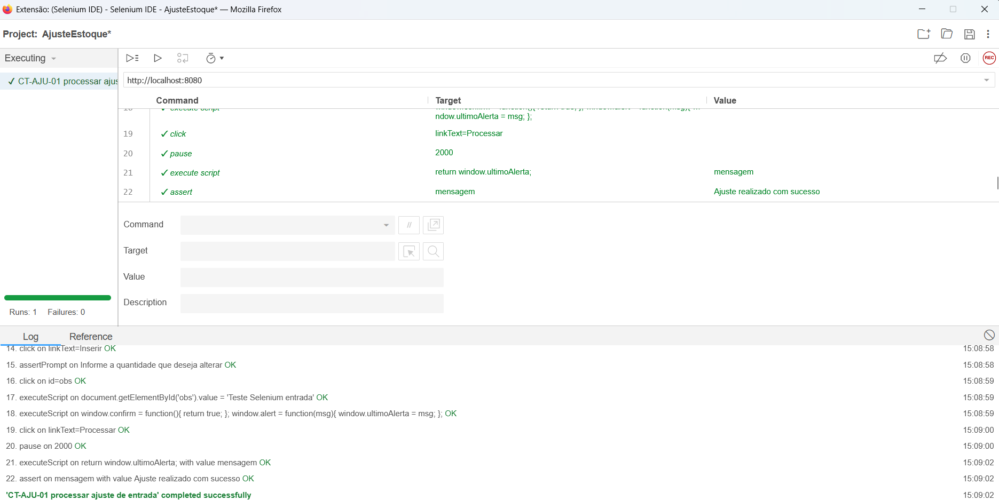

# Testes de sistema (Selenium)

Critério da Entrega 2: implementar testes de sistema considerando requisitos
funcionais, com Selenium.

## AjusteService — Natalia de Abreu Lamas

| Item | Valor |
| --- | --- |
| Ferramenta | Selenium WebDriver 4.13.0 + Chrome (JUnit 5) |
| Classe de teste | [`src/test/java/net/originmobi/pdv/sistema/AjusteSeleniumIT.java`](../../src/test/java/net/originmobi/pdv/sistema/AjusteSeleniumIT.java) |
| Requisitos funcionais | processar ajuste de estoque, atualizar o saldo do produto e cancelar ajuste (pendente e processado) |
| Resultado | **Tests run: 6, Failures: 2** — as 2 falhas são os defeitos [#14](https://github.com/elojas2/trabalho-pdv-2026.1/issues/14) e [#27](https://github.com/elojas2/trabalho-pdv-2026.1/issues/27) |

### Cenários

| # | Cenário | Caso manual | Resultado |
| --- | --- | --- | --- |
| 1 | Processar ajuste de entrada mostra "Ajuste realizado com sucesso", o status fica "Processado" e a observação fica bloqueada | CT-AJU-01 | Passou |
| 2 | Ajuste de entrada (+5) aumenta o saldo do produto em 5 | CT-AJU-01 | **Falhou** — saldo 5 → 0 (esperado 10), [#14](https://github.com/elojas2/trabalho-pdv-2026.1/issues/14) |
| 3 | Ajuste de saída (−3) diminui o saldo do produto em 3 | CT-AJU-02 | **Falhou** — saldo 3 → 6 (esperado 0), [#27](https://github.com/elojas2/trabalho-pdv-2026.1/issues/27) |
| 4 | Cancelar ajuste já processado mostra "O ajuste já esta processado" e o ajuste continua na lista | CT-AJU-03 | Passou |
| 5 | Cancelar ajuste pendente volta à lista, sem o ajuste | CT-AJU-04 | Passou |
| 6 | Responder "Cancelar" na janela de confirmação não remove o ajuste | — | Passou |

Os cenários 2 e 3 falham de propósito: afirmam a regra de negócio e mostram,
pela interface, o mesmo defeito já exposto pelo teste de integração
`AjusteServiceIT` e pelos testes manuais. Estão marcados com `@Tag("defeito")`.
Os valores confirmam a causa: o trigger `atualiza_produto_estoque_AFTER_INSERT`
sempre calcula `saldo - quantidade` (5 − 5 = 0; 3 − (−3) = 6).

### O que o nível de sistema verifica

- **Digitação real** com eventos de teclado (`sendKeys`) no login e na observação.
- **Seleção de produto** pela caixa `bootstrap-select` da tela.
- **Janelas do navegador respondidas de verdade:** a quantidade é digitada no
  `prompt`, a confirmação de processar/cancelar é aceita ou recusada
  (`accept`/`dismiss`) e a mensagem final do sistema é lida no `alert`.
- **Saldo do produto lido na tela** ("Total Estoque" da lista de produtos do ajuste),
  comparando antes e depois do processamento.

Não há rollback: os ajustes criados ficam no banco. Por isso os testes de saldo
comparam o saldo antes e depois, em vez de depender de um valor fixo.

### Como reproduzir

1. Subir o banco e a aplicação (ver o README da raiz) e conferir que
   <http://localhost:8080> abre a tela de login.
2. Com JDK 8, Maven e Chrome instalados, na raiz do projeto:

   ```sh
   mvn test "-Dtest=AjusteSeleniumIT" "-Dmaven.test.failure.ignore=true" "-Dmaven.main.skip=true" "-Dmaven.resources.skip=true"
   ```

   As opções `maven.main.skip` e `maven.resources.skip` evitam recompilar o
   sistema quando a aplicação roda num container que usa a mesma pasta: o
   `spring-boot-devtools` reiniciaria a aplicação no meio do teste.
   Opcional: `-Dheadless=true`, `-Dpdv.url=...`, `-Dpdv.produto=...`.

### Teste complementar: Selenium IDE

O caso CT-AJU-01 também foi gravado no Selenium IDE 3.17.4 (Firefox), no
projeto [`src/test/selenium/AjusteEstoque.side`](../../src/test/selenium/AjusteEstoque.side).
Ele complementa o `AjusteSeleniumIT` com uma segunda ferramenta, mas cobre menos:
por causa da limitação descrita abaixo, a digitação e as janelas foram feitas por
contornos, e o saldo não é conferido.

| Item | Valor |
| --- | --- |
| Teste | `CT-AJU-01 processar ajuste de entrada` |
| Resultado | Passou (22 comandos, 0 falhas) |



**Limitação da ferramenta.** A versão para Chrome do Selenium IDE foi
descontinuada na Chrome Web Store, por isso foi usada a versão para Firefox. Os
comandos que digitam (`type` e `send keys`) falhavam com o erro
`n.createEvent(...).initKeyEvent is not a function`: o Selenium IDE 3.17.4
simula o teclado com uma função que o Firefox atual não tem mais. Pelo mesmo
motivo, a ferramenta não capturava as janelas `confirm`/`alert`.

**Contornos usados nesse teste:** os campos eram preenchidos com
`execute script` (`document.getElementById(...).value = ...`) e as janelas eram
substituídas por funções JavaScript que respondiam OK sozinhas. Com isso, a
digitação real e as janelas de confirmação não eram testadas, e o saldo não era
conferido. Essas três verificações são feitas pelo `AjusteSeleniumIT`.